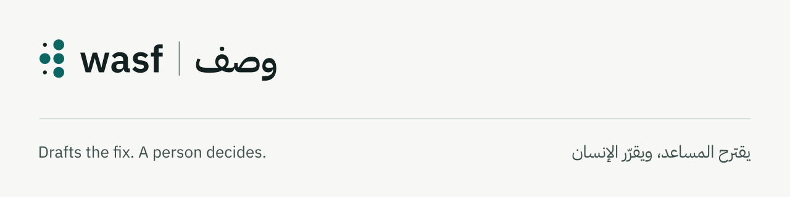

<p align="center">
  <picture>
    <source media="(prefers-color-scheme: dark)" srcset="docs/brand/banner-dark.svg">
    
  </picture>
</p>

# Wasf

Wasf is a bilingual Arabic and English copilot that helps a person remediate inaccessible PDFs towards WCAG 2.1 AA.

## Licence

MIT, see `LICENSE`. The Wasf name and logo are not covered by that licence; you may use them to refer to the project.

## Checks

```bash
python scripts/check.py
```
